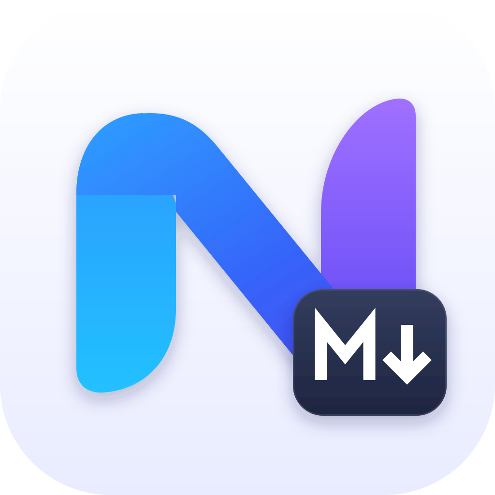
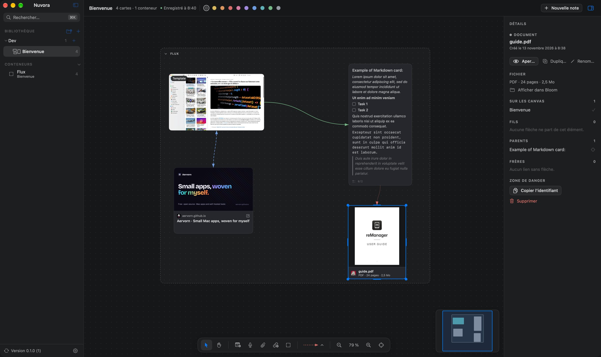
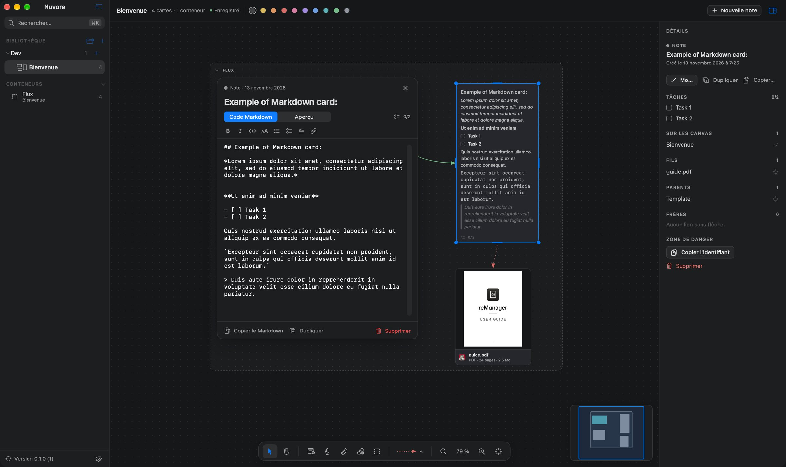
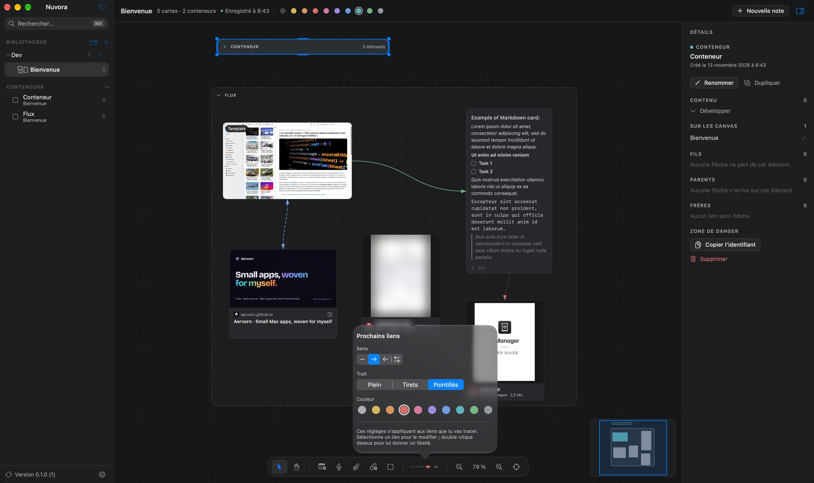
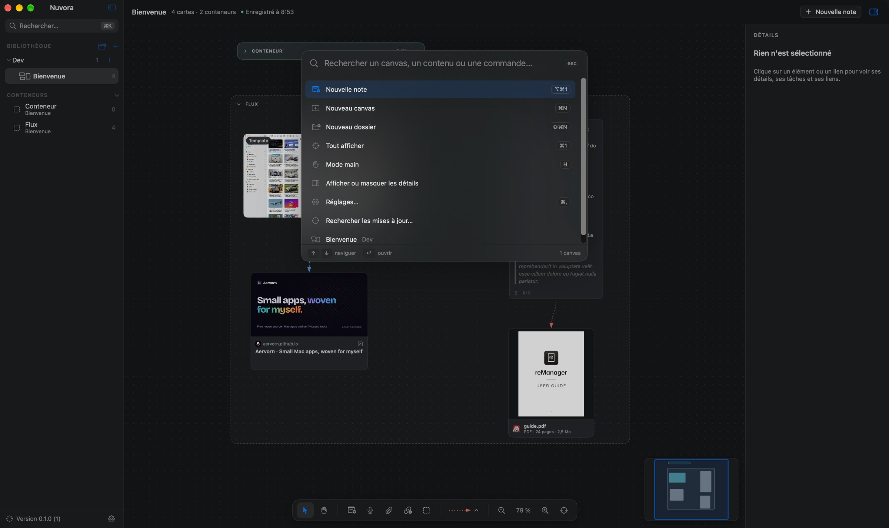
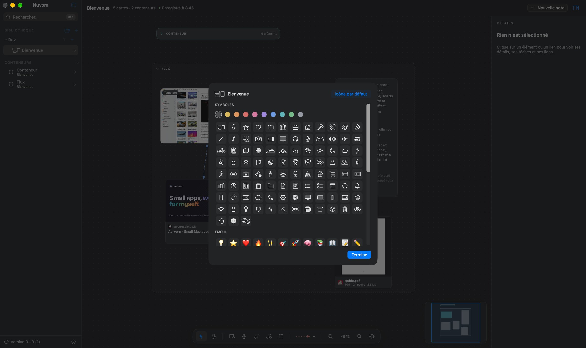

<p align="center">
  <picture>
    <source media="(prefers-color-scheme: dark)" srcset="Design/Nuvora-icon-dark.svg" />
    
  </picture>
</p>

<h1 align="center">Nuvora</h1>

<p align="center">
  <a href="https://github.com/Aervorn/MacOS_Nuvora/releases/latest"></a>
  
  
  
  <a href="LICENSE"></a>
</p>

<p align="center">
  <a href="README.md">🇬🇧 English</a> · 🇫🇷 Français
</p>

---

Nuvora te donne des **canvas infinis** sur macOS pour poser tes idées : notes texte, notes vocales, images, vidéos, documents et liens web, reliés par des flèches et rangés dans des conteneurs que tu peux réduire.

C'est **100 % local** : pas de compte, pas de cloud, pas de télémétrie. Tes canvas vivent dans un dossier de ton Mac, rangés en dossiers, dans une interface native en mode clair ou sombre avec plusieurs thèmes de couleur, en français ou en anglais.

> [!NOTE]
> **Fait avec l'aide de l'IA.** Nuvora est un projet personnel, construit avec [Claude](https://claude.ai), l'assistant IA d'Anthropic : mes compétences seules n'auraient pas suffi à le coder entièrement moi-même. J'ai décidé de ce que l'app devait faire, fait les choix de conception et testé chaque version ; Claude a écrit une grande partie du code. Autant le dire franchement.

## 📸 Captures d'écran

<p align="center">
  
</p>

<p align="center">
  
</p>

<p align="center">
  
</p>

<p align="center">
  
</p>

<p align="center">
  
</p>

## ✨ Fonctionnalités

### ♾️ Canvas infini

- Déplace-toi avec deux doigts (ou la molette), zoome en pinçant ou avec **⌘ + molette**, maintiens **Espace** et glisse pour faire défiler. Un double tapotement à deux doigts affiche tout.
- **⌘1** affiche tout (ou la sélection), **⌘0** revient à 100 %, **⌘+ / ⌘−** zooment.
- Sélectionne d'un clic, avec **⇧** pour ajouter, ou en traçant un rectangle sur le fond. Déplace à la souris ou aux flèches (**⇧** pour aller plus vite), redimensionne par n'importe quel côté ou coin.
- Une **barre flottante** en bas ajoute tous les types d'éléments et règle le type des liens ; une **miniature** en bas à droite montre tout le canvas et déplace la vue quand tu cliques ou glisses dedans.
- L'en-tête indique le nombre de cartes et de conteneurs, si le canvas est enregistré, et propose les couleurs pour la sélection.
- Le **mode main** (H) fait défiler en glissant n'importe où, pratique à la souris ; V revient à la sélection.
- Un **panneau de détails** à droite montre l'élément sélectionné : ses actions, ses tâches, les canvas où il apparaît, et ses **fils** (flèches qui en partent), **parents** (flèches qui y arrivent) et **frères** (liens sans flèche). Un clic centre la vue sur l'un d'eux.
- Fond à points ou quadrillé au choix, et alignement sur la grille.
- Annuler et rétablir sur tout (**⌘Z / ⇧⌘Z**).

### 🔗 Liens entre éléments

- Survole un élément et tire l'un des petits points de ses quatre côtés vers un autre : le lien suit les éléments quand ils bougent.
- Chaque lien a un **sens** (aucun, →, ←, ↔), un trait plein, en tirets ou en pointillés, une couleur et un **libellé** facultatif (double-clic sur le lien). Le type des prochains liens se choisit dans la barre flottante ; sélectionne un lien pour le modifier au même endroit. Un canvas peut mélanger tous les types.
- **⌘L** relie les deux éléments sélectionnés.

### 📦 Conteneurs

- **⌘G** groupe la sélection dans un conteneur ; un élément déposé dans un conteneur lui appartient et bouge avec lui. Les conteneurs peuvent s'imbriquer.
- Un conteneur peut être **partagé entre plusieurs canvas** : clic droit dessus dans la liste Conteneurs de la barre latérale, puis ajoute-le au canvas ouvert, soit synchronisé (une modification faite dans un canvas se retrouve dans les autres à leur prochaine ouverture), soit en copie indépendante.
- Le chevron **réduit** un conteneur : son contenu est masqué, l'en-tête indique combien d'éléments il contient et de quels types, et les liens vers les éléments masqués pointent vers le conteneur.
- **⇧⌘G** dégroupe (le contenu reste).

### 📝 Notes texte

Double-clique sur le fond pour écrire. Les notes s'écrivent en **Markdown** : titres, listes, citations, blocs de code, `**gras**`, `*italique*`, `` `code` ``, `[liens](https://…)`, et des **tâches** (`- [ ] à faire`) à cocher directement sur le canvas, avec leur avancement affiché sur la note. Les notes s'agrandissent pour montrer tout leur texte. Une **barre de mise en forme** apparaît pendant la modification (gras, italique, code, titre, listes, tâches, citation, lien), et un **éditeur complet** (flottant, déplaçable) propose le code Markdown et un aperçu rendu. Neuf couleurs.

### 🎙️ Notes vocales

- Enregistre directement dans Nuvora (**⌥⌘2**) : niveau du micro en direct, puis la note apparaît sur le canvas.
- Aperçu du contenu : **forme d'onde** où cliquer pour aller à un moment, durée, et **transcription** faite **sur ton Mac** par la reconnaissance vocale de macOS (rien n'est envoyé en ligne). Les fichiers audio importés deviennent aussi des notes vocales.
- Une note texte à partir d'une transcription, en un clic.

### 🖼️ Images et vidéos

Dépose-les depuis le Finder, colle-les (**⌘V**) ou ajoute-les avec **⌥⌘3**. Donne-leur un **nom** (clic droit › Renommer…) pour t'y retrouver : il s'affiche sur l'image et la recherche le trouve. Les images gardent leurs proportions ; les vidéos montrent une image et leur durée, et se lisent dans Aperçu rapide.

### 📄 Documents

PDF, Word, Excel, PowerPoint, Keynote, Pages, texte… avec un **aperçu de leur première page** (Quick Look), le type de fichier, le nombre de pages (PDF) et la taille. Double-clic pour Aperçu rapide, ou ouverture dans leur app.

### 🌐 Liens web

Colle une adresse ou utilise **⌥⌘4** : Nuvora affiche une carte avec le **titre, l'image et l'icône du site**, lus une seule fois sur le site lui-même avec LinkPresentation (le framework d'Apple) et gardés avec le canvas. Désactivable dans les réglages si tu préfères qu'aucune page ne soit jamais chargée.

### 🗂️ Canvas et dossiers

Autant de canvas que tu veux, rangés en **dossiers et sous-dossiers** dans la barre latérale. Glisse un canvas ou un dossier sur un dossier pour l'y ranger, duplique, renomme. Chaque canvas peut avoir son **icône** : un symbole teinté, n'importe quel emoji, ou une image à toi. **⌘K** ouvre une palette qui trouve les canvas par leur nom et par leur contenu (notes, transcriptions, noms de fichiers, liens, libellés des liens) et lance les commandes. Une liste **Conteneurs** rassemble les conteneurs de tous les canvas : un clic y conduit. La barre latérale se réduit à une barre d'icônes. Les canvas supprimés vont à la corbeille de macOS.

### 💾 Enregistrement

Les canvas sont enregistrés en continu par défaut. Dans les **Réglages**, tu peux enregistrer toutes les 1 à 30 minutes, ou désactiver l'enregistrement automatique et enregistrer avec **⌘S**. Dans tous les cas, le canvas est enregistré quand tu en changes et quand tu quittes.

### 🎨 Apparence

Mode clair, sombre ou automatique, plusieurs **thèmes de couleur**, et le choix des **polices** de l'interface et du canvas. Les réglages s'ouvrent avec **⌘,** dans la fenêtre. Les fichiers s'affichent dans le Finder ou dans l'app qui le remplace sur ton Mac (détectée automatiquement, ou choisie dans les réglages).

## 🧩 Compatibilité

**macOS 26 (Tahoe) ou plus récent**, sur Mac Apple Silicon et Intel. Interface en français et en anglais (suit macOS, ou se choisit dans les réglages).

## ⌨️ Raccourcis clavier

| Action | Raccourci |
|---|---|
| Nouveau canvas / nouveau dossier | ⌘N / ⇧⌘N |
| Note · note vocale · fichier · lien · conteneur | ⌥⌘1 · ⌥⌘2 · ⌥⌘3 · ⌥⌘4 · ⌥⌘5 |
| Coller sur le canvas (fichiers, image, adresse, texte) | ⌘V |
| Dupliquer · grouper · dégrouper · relier deux éléments | ⌘D · ⌘G · ⇧⌘G · ⌘L |
| Premier plan · arrière-plan | ⇧⌘] · ⇧⌘[ |
| Tout afficher · taille réelle · zoom avant · zoom arrière | ⌘1 · ⌘0 · ⌘+ · ⌘− |
| Modifier l'élément sélectionné / terminer | ↩ / Échap ou ⌘↩ |
| Enregistrer | ⌘S |
| Supprimer | ⌫ |
| Recherche et commandes | ⌘K |
| Mode main · mode sélection | H · V |
| Réglages | ⌘, |

## 🔐 Autorisations

| Autorisation | Pourquoi | Quand |
|---|---|---|
| **Micro** | Enregistrer les notes vocales. | Au premier enregistrement. |
| **Reconnaissance vocale** | Transcrire les notes vocales, sur ton Mac. | À la première transcription (désactivable dans les Réglages). |

Si une langue de transcription n'est pas encore disponible sur ton Mac, télécharge-la en activant la dictée dans **Réglages Système › Clavier**.

## 🔒 Confidentialité

Nuvora ne collecte rien et n'envoie rien te concernant : pas de compte, pas de statistiques, pas de pistage. Tes canvas et leurs fichiers restent sur ton Mac, dans `~/Library/Application Support/Nuvora/` (Time Machine les sauvegarde avec le reste). Les fichiers importés sont copiés dans le canvas, qui reste complet même si l'original bouge.

Les seules requêtes réseau sont :

- l'aperçu d'un lien web que tu ajoutes (titre, image et icône lus sur ce site, une seule fois ; désactivable) ;
- les mises à jour (ce dépôt GitHub).

Les transcriptions se font sur ton Mac : l'audio n'en sort jamais.

## 📥 Installation

1. Télécharge `Nuvora-x.y.z.dmg` depuis la [dernière version](https://github.com/Aervorn/MacOS_Nuvora/releases/latest).
2. Ouvre-le et glisse **Nuvora** sur le dossier **Applications**.
3. Lance Nuvora depuis ton dossier Applications.

> [!WARNING]
> **Nuvora n'est pas notarisé par Apple.** Il est signé avec le certificat de son auteur, pas avec un compte développeur Apple payant : macOS le bloque donc à la première ouverture. C'est normal, et il suffit de l'autoriser une fois :
>
> 1. Ouvre Nuvora : macOS indique qu'il ne peut pas le vérifier. Clique sur **Terminé**.
> 2. Ouvre **Réglages Système › Confidentialité et sécurité** et descends jusqu'à la section **Sécurité**.
> 3. À côté du message concernant Nuvora, clique sur **Ouvrir quand même**, puis confirme avec ton mot de passe.
>
> Si tu préfères le Terminal : `xattr -dr com.apple.quarantine /Applications/Nuvora.app`
>
> Tu peux vérifier que le téléchargement est authentique en comparant son empreinte SHA-256 (`shasum -a 256 Nuvora-x.y.z.dmg`) avec celle indiquée dans les notes de version.

## 🔄 Mettre à jour

Nuvora se met à jour tout seul : il cherche une nouvelle version une fois par jour et propose de l'installer, avec ses notes de version (ou passe par **Nuvora › Rechercher les mises à jour…**). Les mises à jour sont signées, et Nuvora refuse tout fichier qui n'a pas été signé par l'auteur. La recherche automatique se désactive dans les **Réglages**. Tes canvas et tes réglages sont conservés.

## 📝 Historique des versions

### 0.1.0
- Première version : canvas infinis rangés en dossiers, notes texte, notes vocales avec forme d'onde et transcription sur le Mac, images, vidéos, documents avec aperçu, liens web avec aperçu.
- Liens avec sens, style, couleur et libellé ; conteneurs imbriquables et réductibles.
- Notes en Markdown avec tâches, panneau de détails, mode main, thèmes de couleur, icônes des canvas, palette ⌘K, liste des conteneurs.
- Barre flottante, miniature, recherche par nom et par contenu, enregistrement en continu ou toutes les quelques minutes.
- Glisser-déposer et coller depuis le Finder et les autres apps, annuler et rétablir, grille et alignement.
- Interface en français et en anglais, mode clair et sombre, icône pensée pour macOS 26, fenêtre À propos et mises à jour Sparkle.

## 🛠️ Compiler depuis les sources

Prérequis : Xcode 26 ou plus récent, macOS 26 ou plus récent, et [XcodeGen](https://github.com/yonaskolb/XcodeGen) (le projet Xcode est généré depuis `project.yml`).

```bash
brew install xcodegen
git clone https://github.com/Aervorn/MacOS_Nuvora.git
cd MacOS_Nuvora
xcodegen generate
open Nuvora.xcodeproj
```

Choisis le schéma **Nuvora** et **Mon Mac**, puis **Product › Run** (⌘R). Les tests se lancent avec **Product › Test** (⌘U). Le projet est réglé sur **Sign to Run Locally** : pas besoin de compte développeur Apple. Après un `git pull` qui ajoute ou retire des fichiers, relance `xcodegen generate`.

```
Nuvora/
├── NuvoraApp.swift         point d'entrée, fenêtres et menus
├── Core/                   modèle sans interface (testé) : éléments, liens, conteneurs, bibliothèque, géométrie
├── Services/               stockage de la bibliothèque et des canvas, médias, audio et transcription, aperçus des liens, mises à jour
├── Views/                  interface SwiftUI (barre latérale, canvas, éléments, réglages, À propos)
├── Resources/              traductions (String Catalogs)
└── AppIcon.icon            icône de l'app (Icon Composer)
NuvoraTests/                tests (Swift Testing)
Design/                     calques de l'icône, fond du DMG et les scripts qui les génèrent
scripts/make-dmg.sh         fabrique le DMG d'une version et l'appcast de Sparkle
```

Les textes de l'interface sont écrits en français dans le code ; leur traduction anglaise est dans `Nuvora/Resources/Localizable.xcstrings` (Xcode y ajoute les nouveaux textes à chaque compilation).

Pour fabriquer un DMG comme ceux publiés, `scripts/make-dmg.sh` génère le projet, archive l'app, vérifie sa signature et crée l'image disque. Il demande [create-dmg](https://github.com/create-dmg/create-dmg) (`brew install create-dmg`) et un certificat de signature, dont le nom est indiqué en haut du script. Il signe aussi le DMG pour Sparkle et réécrit `appcast.xml`, ce qui demande une clé EdDSA dans ton trousseau (`generate_keys`, fourni avec Sparkle) dont la partie publique est dans `project.yml`.

## 🤝 Contribuer et signaler un problème

Les signalements de bugs, les idées et les pull requests sont les bienvenus !

- **Un bug ?** [Ouvre un ticket](https://github.com/Aervorn/MacOS_Nuvora/issues/new) avec ta version de macOS, ce que tu as fait et ce qui s'est passé. Une capture d'un canvas de test aide beaucoup.
- **Une pull request ?** Garde-la centrée sur un seul changement, et vérifie que les tests passent (⌘U). Écris les textes de l'interface en français dans le code et ajoute leur traduction anglaise au String Catalog.

## ⚠️ Avertissement

Nuvora est fourni **« tel quel », sans aucune garantie**. Garde des sauvegardes de ce qui compte (Time Machine couvre le dossier de Nuvora). L'auteur ne peut être tenu responsable d'une perte de données ou de tout autre dommage.

## 📄 Licence

Nuvora est distribué sous [licence MIT](LICENSE).

Les mises à jour utilisent [Sparkle](https://sparkle-project.org), distribué sous licence MIT.
