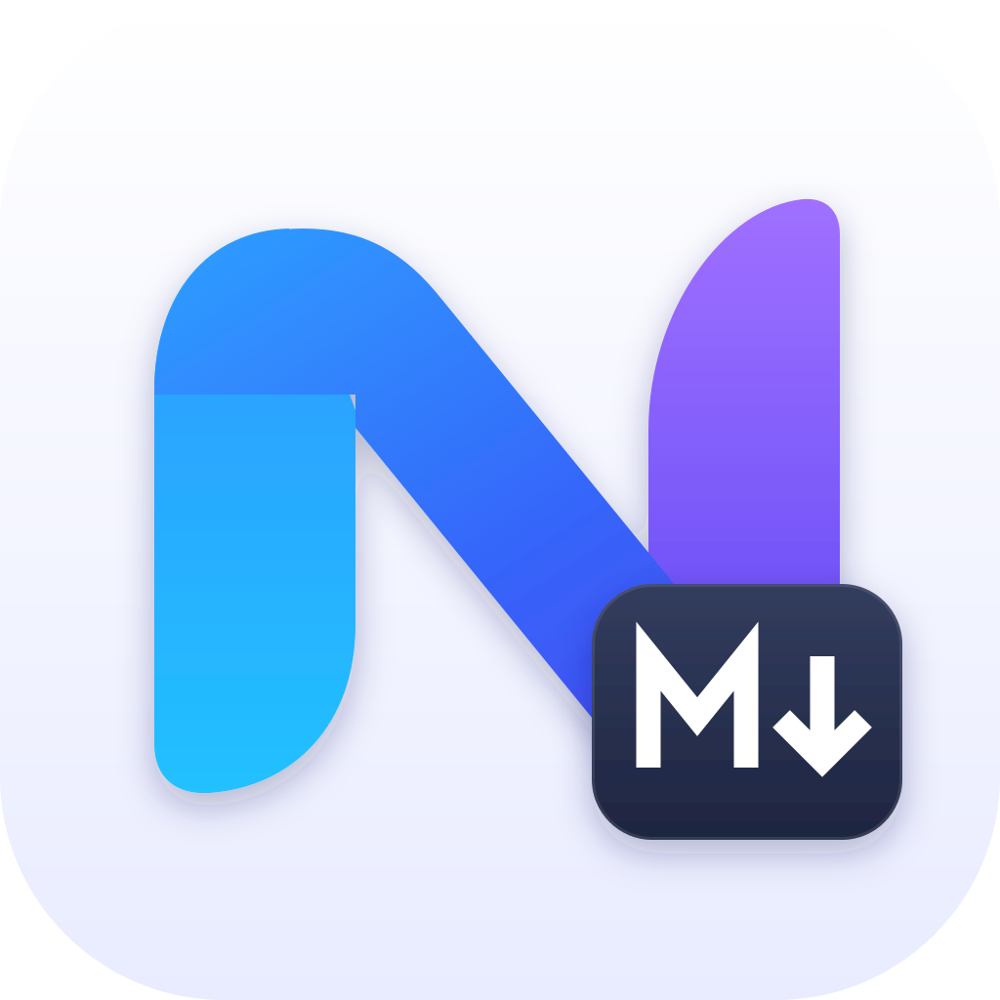
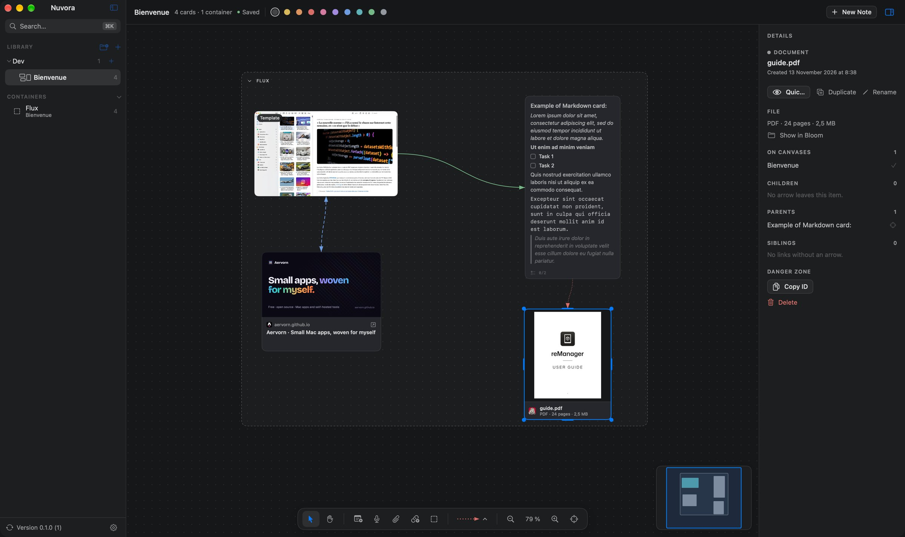
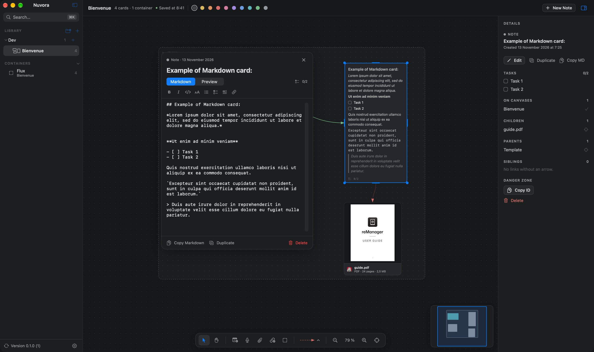
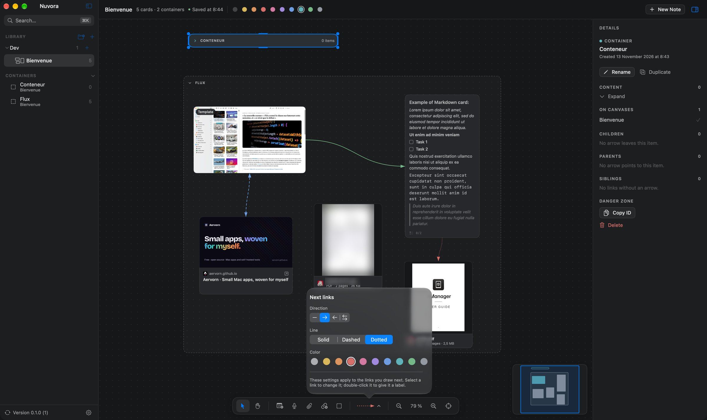
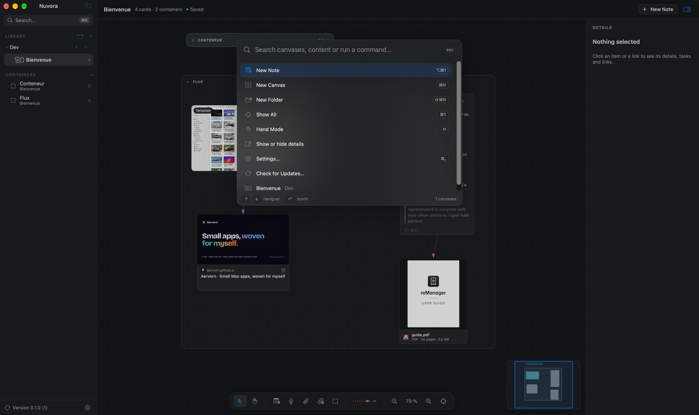
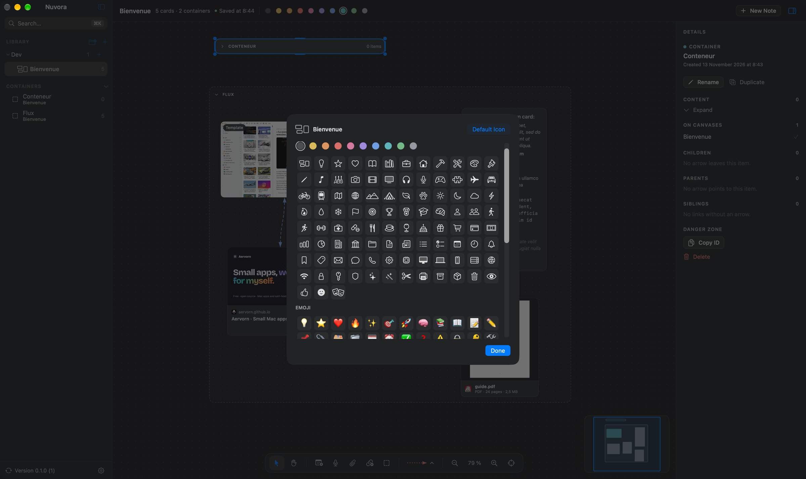

<p align="center">
  <picture>
    <source media="(prefers-color-scheme: dark)" srcset="Design/Nuvora-icon-dark.svg" />
    
  </picture>
</p>

<h1 align="center">Nuvora</h1>

<p align="center">
  <a href="https://github.com/Aervorn/MacOS_Nuvora/releases/latest"></a>
  
  
  
  <a href="LICENSE"></a>
</p>

<p align="center">
  🇬🇧 English · <a href="README.fr.md">🇫🇷 Français</a>
</p>

---

Nuvora gives you **infinite canvases** on macOS to lay out your ideas: text notes, voice notes, images, videos, documents and web links, connected with arrows and grouped in containers you can collapse.

It's **100% local**: no account, no cloud, no telemetry. Your canvases live in a folder on your Mac, organized in folders, in a native interface in light or dark mode with several color themes, in English or French.

> [!NOTE]
> **Built with the help of AI.** Nuvora is a personal project I built with [Claude](https://claude.ai), Anthropic's AI assistant: my skills alone wouldn't have been enough to code it entirely by myself. I decided what the app should do, made the design choices and tested every version; Claude wrote a large part of the code. Just being upfront about it.

## 📸 Screenshots

<p align="center">
  
</p>

<p align="center">
  
</p>

<p align="center">
  
</p>

<p align="center">
  
</p>

<p align="center">
  
</p>

## ✨ Features

### ♾️ Infinite canvas

- Move around with two fingers (or the scroll wheel), zoom by pinching or with **⌘ + scroll**, hold **Space** and drag to pan. A two-finger double-tap shows everything.
- **⌘1** shows everything (or the selection), **⌘0** goes back to 100%, **⌘+ / ⌘−** zoom in and out.
- Select by clicking, with **⇧** to add, or by drawing a rectangle on the background. Move with the mouse or the arrow keys (**⇧** for bigger steps), resize from any side or corner.
- A **floating bar** at the bottom adds every kind of item and sets the type of the links; a **minimap** in the bottom-right corner shows the whole canvas and moves the view when you click or drag in it.
- The header shows the number of cards and containers, whether the canvas is saved, and the colors for the selection.
- **Hand mode** (H) pans by dragging anywhere, handy with a mouse; V goes back to selecting.
- A **details panel** on the right shows the selected item: its actions, its tasks, the canvases it appears on, and its **children** (arrows leaving it), **parents** (arrows reaching it) and **siblings** (links without an arrow). Click one to center the view on it.
- Optional dot or line grid, and snapping to the grid.
- Full undo and redo (**⌘Z / ⇧⌘Z**).

### 🔗 Links between items

- Hover over an item and drag one of the small dots on its four sides onto another one: the link follows the items when they move.
- Each link has a **direction** (none, →, ←, ↔), a solid, dashed or dotted line, a color and an optional **label** (double-click the link). Choose the type of the next links in the floating bar; select a link to change it there. A canvas can mix every type.
- **⌘L** connects the two selected items.

### 📦 Containers

- **⌘G** groups the selection in a container; items dropped inside a container belong to it and move with it. Containers can be nested.
- A container can be **shared between canvases**: right-click it in the sidebar's Containers list and add it to the open canvas, either synced (a change made in one canvas shows in the others the next time they open) or as an independent copy.
- Click the chevron to **collapse** a container: its content is hidden, the header shows how many items it holds and of which kinds, and links to hidden items now point to the container.
- **⇧⌘G** ungroups (the content stays).

### 📝 Text notes

Double-click the background to write. Notes are written in **Markdown**: headings, lists, quotes, code blocks, `**bold**`, `*italic*`, `` `code` ``, `[links](https://…)`, and **tasks** (`- [ ] to do`) you tick straight on the canvas, with their progress shown on the note. Notes grow to show all their text. A **formatting bar** appears while you edit (bold, italic, code, heading, lists, tasks, quote, link), and a **full editor** (floating, movable) offers the Markdown code and a rendered preview. Nine colors.

### 🎙️ Voice notes

- Record straight from Nuvora (**⌥⌘2**): live level meter, then the note appears on the canvas.
- Preview of the content: **waveform** you can click to jump to a moment, duration, and **transcript** made **on your Mac** by macOS speech recognition (nothing is sent online). Audio files you import become voice notes too.
- Create a text note from a transcript in one click.

### 🖼️ Images and videos

Drop them from the Finder, paste them (**⌘V**), or add them with **⌥⌘3**. Give them a **name** (right-click › Rename…) to find them more easily: it is shown on the image and found by the search. Images keep their proportions; videos show a frame and their duration, and play in Quick Look.

### 📄 Documents

PDF, Word, Excel, PowerPoint, Keynote, Pages, text… with a **preview of their first page** (Quick Look), file type, page count (PDF) and size. Double-click for Quick Look, or open them in their app.

### 🌐 Web links

Paste an address or use **⌥⌘4**: Nuvora shows a card with the page's **title, image and site icon**, read once from the site itself with Apple's LinkPresentation and kept with the canvas. Turn it off in Settings if you'd rather no page is ever loaded.

### 🗂️ Canvases and folders

As many canvases as you like, sorted in **folders and subfolders** in the sidebar. Drag a canvas or a folder onto a folder to move it, duplicate, rename. Each canvas can have its own **icon**: a tinted symbol, any emoji, or an image of yours. **⌘K** opens a palette that finds canvases by name and by content (notes, transcripts, file names, links, link labels) and runs commands. A **Containers** list gathers the containers of every canvas: click one to jump to it. The sidebar collapses to a bar of icons. Deleted canvases go to the macOS Trash.

### 💾 Saving

Canvases are saved continuously by default. In **Settings** you can save every 1 to 30 minutes instead, or turn autosave off and save with **⌘S**. In every case the canvas is saved when you switch to another one and when you quit.

### 🎨 Appearance

Light, dark or automatic mode, several **color themes**, and your choice of **fonts** for the interface and for the canvas. Settings open with **⌘,** inside the window. Files are shown in the Finder or in the app that replaces it on your Mac (detected automatically, or chosen in Settings).

## 🧩 Compatibility

**macOS 26 (Tahoe) or later**, on Apple Silicon and Intel Macs. Interface in English and French (follows macOS, or can be chosen in Settings).

## ⌨️ Keyboard shortcuts

| Action | Shortcut |
|---|---|
| New canvas / new folder | ⌘N / ⇧⌘N |
| Note · voice note · file · link · container | ⌥⌘1 · ⌥⌘2 · ⌥⌘3 · ⌥⌘4 · ⌥⌘5 |
| Paste onto the canvas (files, image, address, text) | ⌘V |
| Duplicate · group · ungroup · connect two items | ⌘D · ⌘G · ⇧⌘G · ⌘L |
| Bring to front · send to back | ⇧⌘] · ⇧⌘[ |
| Show all · actual size · zoom in · zoom out | ⌘1 · ⌘0 · ⌘+ · ⌘− |
| Edit the selected item / stop editing | ↩ / Esc or ⌘↩ |
| Save | ⌘S |
| Delete | ⌫ |
| Search and commands | ⌘K |
| Hand mode · selection mode | H · V |
| Settings | ⌘, |

## 🔐 Required permissions

| Permission | Why | When |
|---|---|---|
| **Microphone** | Recording voice notes. | The first time you record. |
| **Speech recognition** | Transcribing voice notes, on your Mac. | The first transcript (can be turned off in Settings). |

If a transcript language isn't available on your Mac yet, download it by turning on Dictation in **System Settings › Keyboard**.

## 🔒 Privacy

Nuvora collects nothing and sends nothing about you: no account, no analytics, no tracking. Your canvases and their files stay on your Mac, in `~/Library/Application Support/Nuvora/` (Time Machine backs them up with the rest of your Mac). Imported files are copied into the canvas, so it stays complete even if the original moves.

The only network requests are:

- the preview of a web link you add (title, image and icon read from that site, once; can be turned off);
- updates (this GitHub repository).

Voice transcripts are made on your Mac: the audio never leaves it.

## 📥 Installation

1. Download `Nuvora-x.y.z.dmg` from the [latest release](https://github.com/Aervorn/MacOS_Nuvora/releases/latest).
2. Open it and drag **Nuvora** onto the **Applications** folder.
3. Launch Nuvora from your Applications folder.

> [!WARNING]
> **Nuvora isn't notarized by Apple.** It's signed with the author's own certificate, not with a paid Apple Developer account, so macOS blocks it the first time it's opened. This is expected; you only need to allow it once:
>
> 1. Open Nuvora: macOS says it can't verify it. Click **Done**.
> 2. Open **System Settings › Privacy & Security** and scroll down to the **Security** section.
> 3. Next to the message about Nuvora, click **Open Anyway**, then confirm with your password.
>
> If you prefer the Terminal: `xattr -dr com.apple.quarantine /Applications/Nuvora.app`
>
> You can check that the download is genuine by comparing its SHA-256 checksum (`shasum -a 256 Nuvora-x.y.z.dmg`) with the one given in the release notes.

## 🔄 Updating

Nuvora updates itself: it checks for a new version once a day and offers to install it, with its release notes (or use **Nuvora › Check for Updates…**). Updates are signed, and Nuvora refuses any file that wasn't signed by the author. Automatic checking can be turned off in **Settings**. Your canvases and settings are kept.

## 📝 Changelog

### 0.1.0
- First version: infinite canvases organized in folders, text notes, voice notes with waveform and on-device transcript, images, videos, documents with preview, web links with preview.
- Links with direction, style, color and label; containers you can nest and collapse.
- Markdown notes with tasks, details panel, hand mode, color themes, canvas icons, ⌘K palette, list of containers.
- Floating bar, minimap, search by name and content, autosave continuously or every few minutes.
- Drag and drop and paste from the Finder and other apps, undo and redo, grid and snapping.
- Interface in English and French, light and dark mode, app icon for macOS 26, About window and Sparkle updates.

## 🛠️ Building from source

Requirements: Xcode 26 or later, macOS 26 or later, and [XcodeGen](https://github.com/yonaskolb/XcodeGen) (the Xcode project is generated from `project.yml`).

```bash
brew install xcodegen
git clone https://github.com/Aervorn/MacOS_Nuvora.git
cd MacOS_Nuvora
xcodegen generate
open Nuvora.xcodeproj
```

Choose the **Nuvora** scheme and **My Mac**, then **Product › Run** (⌘R). Tests run with **Product › Test** (⌘U). The project is set to **Sign to Run Locally**: no Apple developer account is needed. After a `git pull` that adds or removes files, run `xcodegen generate` again.

```
Nuvora/
├── NuvoraApp.swift         entry point, windows and menus
├── Core/                   UI-free model (tested): items, links, containers, library, geometry
├── Services/               library and canvas storage, media, audio and transcript, link previews, updates
├── Views/                  SwiftUI interface (sidebar, canvas, items, settings, About)
├── Resources/              translations (String Catalogs)
└── AppIcon.icon            app icon (Icon Composer)
NuvoraTests/                tests (Swift Testing)
Design/                     icon layers, DMG background and the scripts that generate them
scripts/make-dmg.sh         builds the DMG of a release and the Sparkle appcast
```

Interface texts are written in French in the code; their English translation lives in `Nuvora/Resources/Localizable.xcstrings` (Xcode adds new texts to it at each build).

To build a DMG like the published ones, `scripts/make-dmg.sh` generates the project, archives the app, checks its signature and creates the disk image. It needs [create-dmg](https://github.com/create-dmg/create-dmg) (`brew install create-dmg`) and a signing certificate, whose name is set at the top of the script. It also signs the DMG for Sparkle and rewrites `appcast.xml`, which needs an EdDSA key in your keychain (`generate_keys`, shipped with Sparkle) whose public part is in `project.yml`.

## 🤝 Contributing & issues

Bug reports, ideas and pull requests are welcome!

- **Found a bug?** [Open an issue](https://github.com/Aervorn/MacOS_Nuvora/issues/new) with your macOS version, what you did and what happened. A screenshot of a test canvas helps a lot.
- **A pull request?** Keep it focused on one change, and make sure the tests pass (⌘U). Write interface texts in French in the code and add their English translation to the String Catalog.

## ⚠️ Disclaimer

Nuvora is provided **“as is”, without any warranty**. Keep backups of what matters (Time Machine covers Nuvora's folder). The author can't be held responsible for any data loss or other damage.

## 📄 License

Nuvora is released under the [MIT License](LICENSE).

Updates use [Sparkle](https://sparkle-project.org), released under the MIT License.
